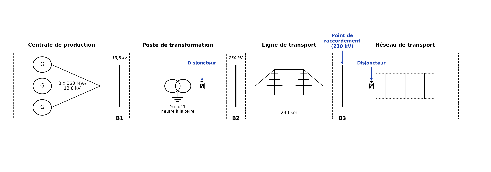
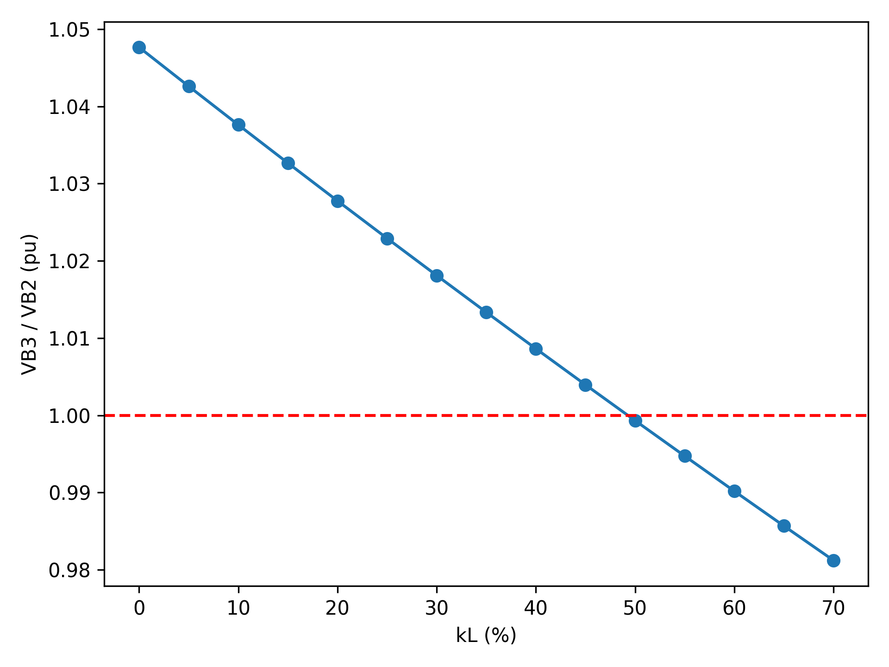
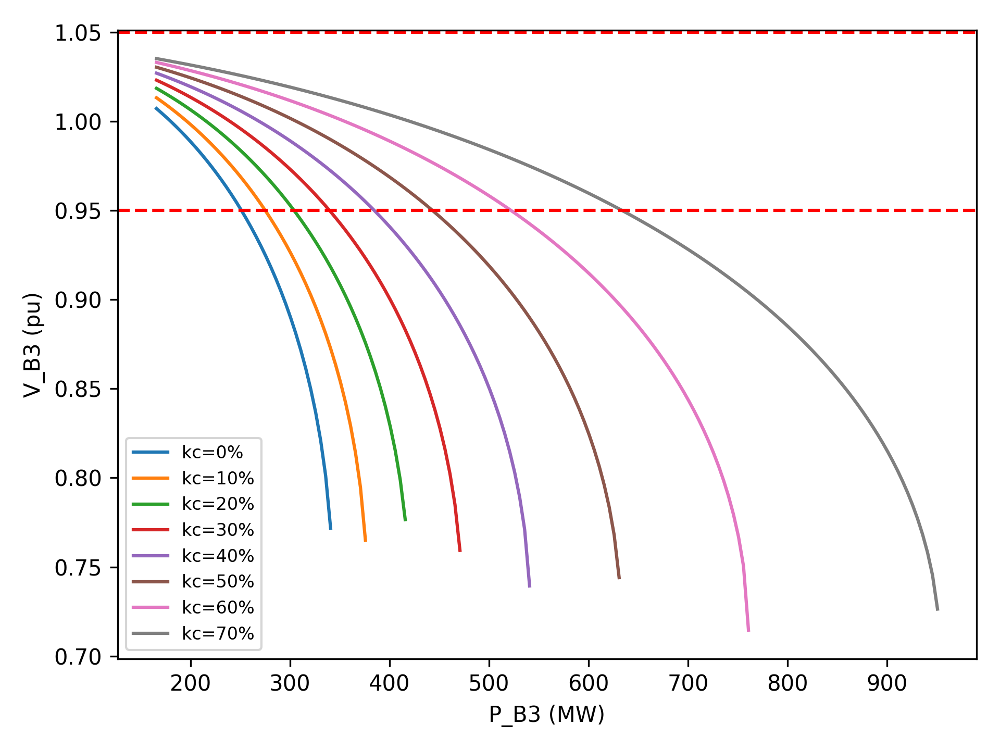
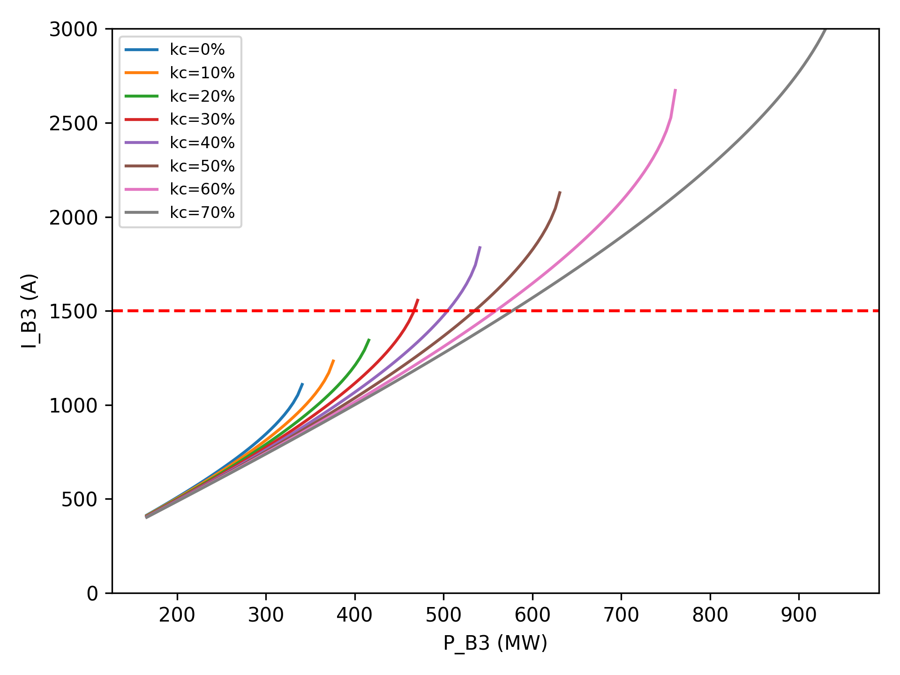
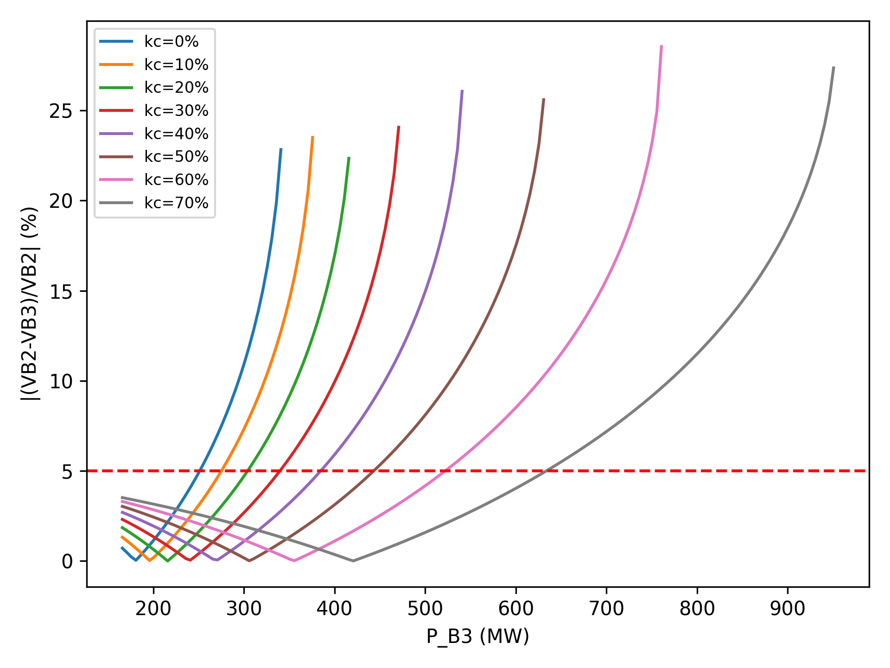
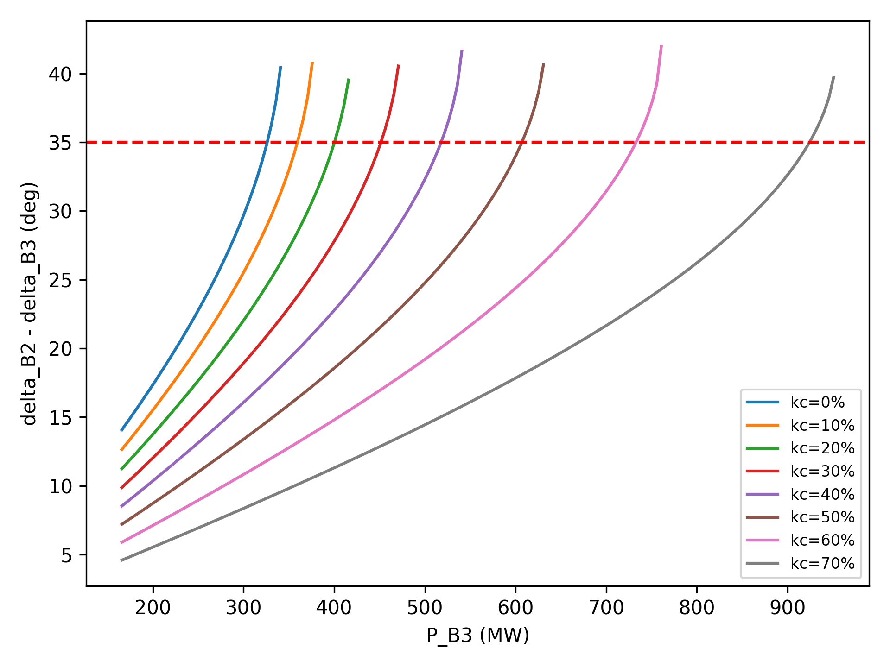

# Ligne de transport 230 kV — Compensation et régime de défaut

> Étude numérique d'une ligne aérienne triphasée de 240 km : paramètres linéiques, modèle ABCD, compensation série et shunt, courant de court-circuit et schéma unifilaire.
>
> *Numerical study of a 240 km three-phase overhead line: line parameters, ABCD model, series and shunt compensation, short-circuit current and single-line diagram.*


---

## Aperçu / Overview

**FR** — Projet de cours d'électrotechnique : caractériser une ligne de transport **230 kV** reliant un jeu de barres B2 à un jeu de barres B3, puis déterminer la compensation nécessaire pour tenir la tension, la chute de tension, l'angle de transport et le courant dans les limites admissibles. Les scripts calculent d'abord les paramètres linéiques à partir de la géométrie (faisceau de 4 conducteurs), puis explorent les taux de compensation **série** et **shunt**, et terminent par un calcul de **courant de défaut** en valeurs par unité.

**EN** — Electrical engineering course project: characterise a **230 kV** transmission line between buses B2 and B3, then determine the compensation required to keep voltage, voltage drop, transmission angle and current within limits. The scripts first compute the line parameters from the geometry (4-conductor bundle), then explore **series** and **shunt** compensation ratios, and finish with a **fault current** calculation in per-unit.

## Paramètres de la ligne / Line parameters

| Grandeur | Valeur |
|---|---|
| Fréquence | 60 Hz |
| Longueur | 240 km |
| Tension nominale (B2–B3) | 230 kV |
| Conducteurs | faisceau de 4, diamètre 1,424 po |
| Distance entre conducteurs du faisceau | 0,45 m |
| Espacement des phases | 12 m (disposition triangulaire) |
| Résistance du conducteur | 0,0803 Ω/mi à 50 °C |
| Courant maximal par conducteur | 1 250 A |

Les paramètres linéiques `R'`, `L'`, `C'` sont dérivés du **GMR** du faisceau et de la **GMD** des phases, puis multipliés par la longueur. La ligne est modélisée en **π** (ABCD), le transformateur élévateur en **T**.

## Scripts

| Fichier | Rôle |
|---|---|
| `parametres_ligne.py` | Géométrie, GMR/GMD, `R`, `X`, `B`, impédance caractéristique, SIL, matrice ABCD — **module importé par les autres scripts** |
| `compensation_serie.py` | Modèle ABCD transformateur + ligne, balayage du taux de compensation `kc`, limites 0,95–1,05 pu / 5 % / 35° / 30 % de `Imax` |
| `compensation_shunt.py` | Modèle π, compensation shunt par réactances, profil de tension selon `kL` |
| `court_circuit.py` | Impédances en pu (générateur, transformateur, ligne), courant de défaut |
| `reseau_ligne.py` | Calculs de réseau et de charge sur la ligne (version consolidée) |
| `Image.py` | Schéma unifilaire annoté (patches Matplotlib), importe `compensation_shunt` |

## Résultats / Results

### Schéma unifilaire / Single-line diagram



### Compensation shunt / Shunt compensation



### Compensation série / Series compensation

| Tension au jeu de barres B3 | Courant de ligne |
|---|---|
|  |  |

| Chute de tension | Angle de transport |
|---|---|
|  |  |

Chaque courbe est tracée pour plusieurs taux de compensation `kc` ; les lignes rouges pointillées marquent les limites admissibles (0,95–1,05 pu, 5 %, 35°, 30 % de `Imax`).

## Installation / Usage

```bash
python -m venv venv
venv\Scripts\activate
pip install -r requirements.txt

python parametres_ligne.py     # affiche R, X, B, Zc, SIL, ABCD
python compensation_serie.py   # figures VB3 / IB3 / dV / angle
python compensation_shunt.py   # figure ratio_vs_kL
python court_circuit.py
python Image.py                # schéma unifilaire
```

Les figures sont enregistrées dans le dossier courant (300 dpi, fond transparent) et affichées à l'écran.

## Hypothèses / Assumptions

- Ligne triphasée symétrique, transposée, sans pertes de fuite.
- Modèle π pour la ligne, modèle en T pour le transformateur 1050 MVA, 13,8/230 kV.
- Charge modélisée par une puissance active constante ; facteur de puissance unitaire.
- Court-circuit franc (métallique) aux barres, générateur représenté par sa réactance transitoire `Xd' = 0,15 pu`.
- Résultats **pédagogiques**, non validés contre un logiciel industriel (PSS/E, PowerFactory).

## Limites / Limitations

- Pas de régime transitoire ni de stabilité ; uniquement le régime permanent.
- Les limites de compensation sont celles du cahier des charges du cours.
- Les scripts partagent `parametres_ligne.py` : les modifier ensemble pour changer la géométrie.
- `reseau_ligne.py` et `compensation_shunt.py` couvrent des variantes du même calcul ; ils ne sont pas fusionnés.

## Ce que j'ai appris / What I learned

- Passer d'une géométrie de pylône à des paramètres électriques exploitables (GMR, GMD, faisceau).
- Manipuler les paramètres ABCD et les valeurs par unité sur un réseau à trois jeux de barres.
- Déterminer un taux de compensation qui respecte plusieurs contraintes simultanées.
- Calculer un courant de défaut et l'interpréter en pu.
- Produire des figures lisibles pour un rapport technique.

## Crédits / Credits

- **Auteur** : Tristan Faucher, Université de Sherbrooke.
- Travaux de cours en électrotechnique publiés à des fins de portfolio.
- Ce dépôt était auparavant mélangé avec des scripts de convertisseurs DC-DC ; ces derniers sont maintenant dans [`convertisseurs-dc-dc`](https://github.com/LeVoileuxFaucher/convertisseurs-dc-dc).

## Licence / License

© Tristan Faucher. Tous droits réservés. Code publié à titre de démonstration.
